# Performance history

Measured on every push to `main` by `.github/workflows/perf.yml`; this branch is written by CI only.
JS and CSS sizes are gzip. Timings are medians of 3 loads on a shared runner without a GPU, so watch their trend, not single values.

Latest: [`016b41c`](https://github.com/AxelUser/maltsev.space/commit/016b41ce2d1e72453200b01f01fded6ffa9bbd82) AI agent skills (#33) (2026-11-23). 7 runs recorded.

## Latest

| Page | Device | Upfront JS | Total JS | Total JS vs [`69649a6`](https://github.com/AxelUser/maltsev.space/commit/69649a642adf9e85fa19759bfed421bfd278cee2) | LCP | Blocking time |
|---|---|--:|--:|--:|--:|--:|
| Home | desktop | 123.9 KB | 124.9 KB | −0.7 KB | 188 ms | 0 ms |
| Home | mobile | 123.9 KB | 124.9 KB | −0.7 KB | 184 ms | 87 ms |
| Blog index | desktop | 119.3 KB | 121.9 KB | −1.0 KB | 172 ms | 0 ms |
| Blog index | mobile | 119.3 KB | 121.9 KB | −1.0 KB | 260 ms | 92 ms |
| About | desktop | 117.7 KB | 125.2 KB | +1.0 KB | 168 ms | 0 ms |
| About | mobile | 117.7 KB | 125.2 KB | +1.0 KB | 224 ms | 50 ms |
| Misc | desktop | 116.9 KB | 124.9 KB | +1.1 KB | 160 ms | 87 ms |
| Misc | mobile | 116.9 KB | 124.9 KB | +1.1 KB | 428 ms | 684 ms |
| Misc collection | desktop | 115.9 KB | 124.0 KB | +1.1 KB | 136 ms | 87 ms |
| Misc collection | mobile | 115.9 KB | 124.0 KB | +1.1 KB | 152 ms | 623 ms |
| Post | desktop | 126.8 KB | 129.8 KB | +1.1 KB | 180 ms | 0 ms |
| Post | mobile | 126.8 KB | 129.8 KB | +1.1 KB | 328 ms | 83 ms |
| Post with live cover | desktop | 126.8 KB | 285.5 KB | +7.2 KB | 300 ms | 540 ms |
| Post with live cover | mobile | 126.8 KB | 143.2 KB | +4.7 KB | 1200 ms | 396 ms |
| Post with diagrams | desktop | 126.8 KB | 142.3 KB | −168.3 KB | 132 ms | 5 ms |
| Post with diagrams | mobile | 126.8 KB | 142.3 KB | −168.3 KB | 464 ms | 350 ms |
| 404 | desktop | 26.0 KB | 128.3 KB | −97.7 KB | 116 ms | 0 ms |
| 404 | mobile | 26.0 KB | 128.3 KB | −97.7 KB | 352 ms | 70 ms |

## Trends (last 7 runs)

### Home

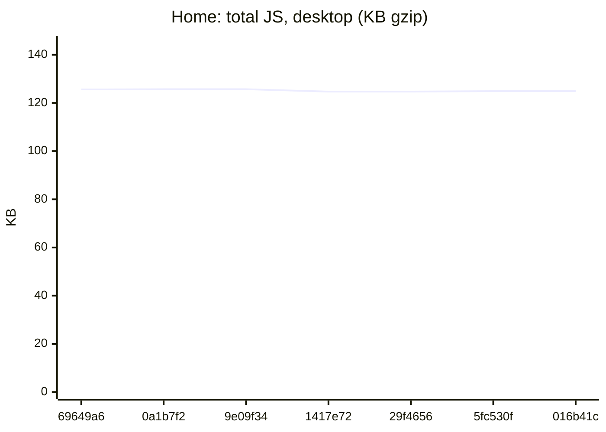

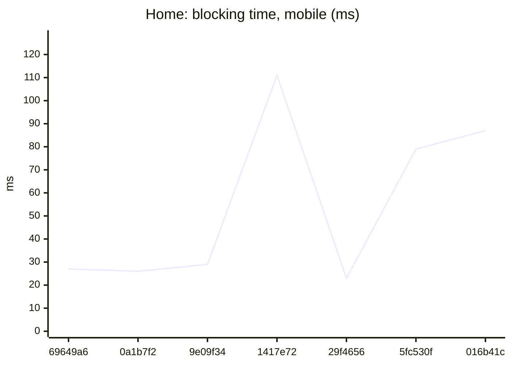

### Blog index

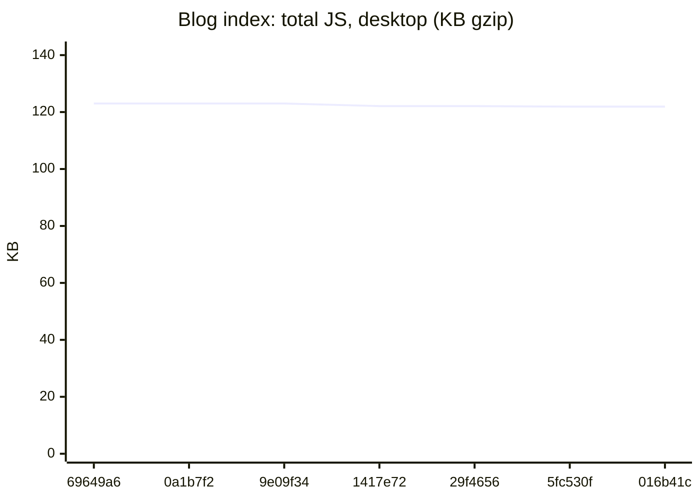

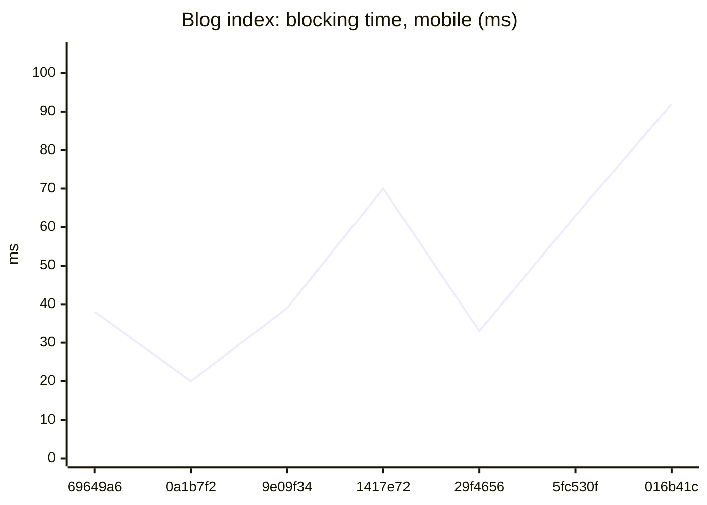

### About

### Misc

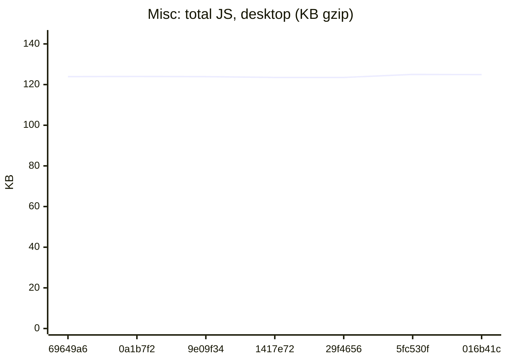

### Misc collection

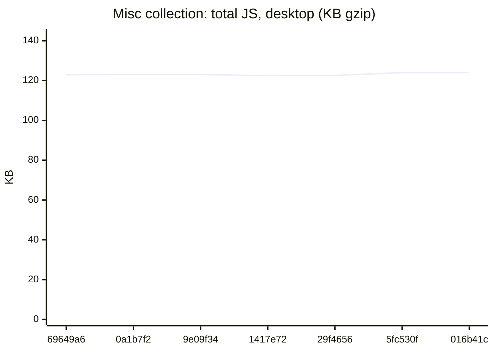

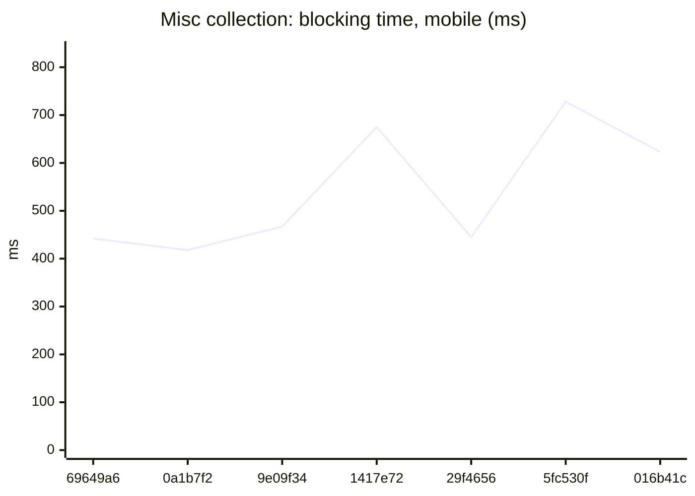

### Post

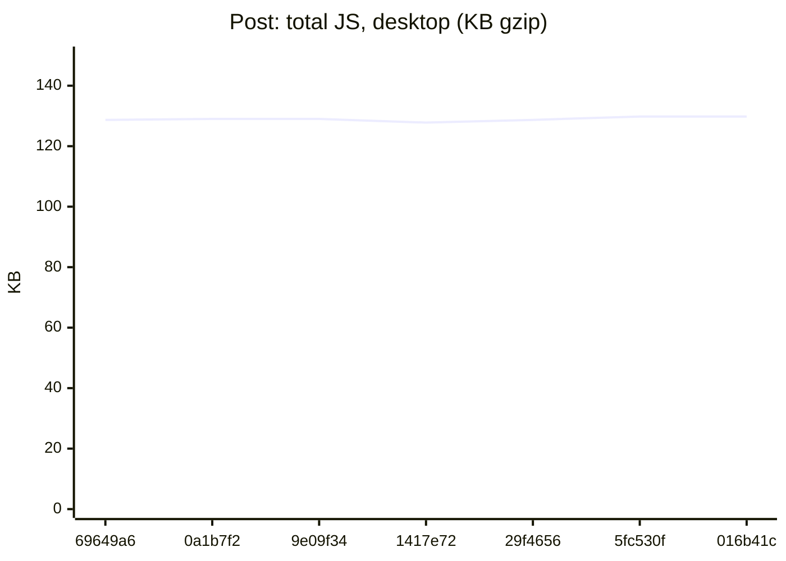

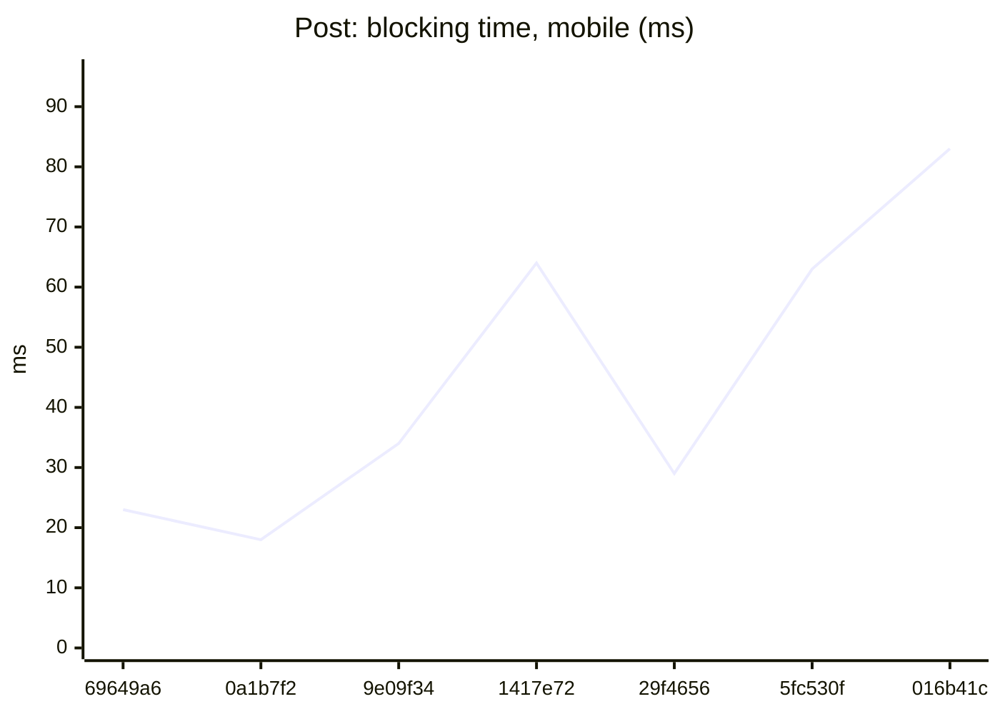

### Post with live cover

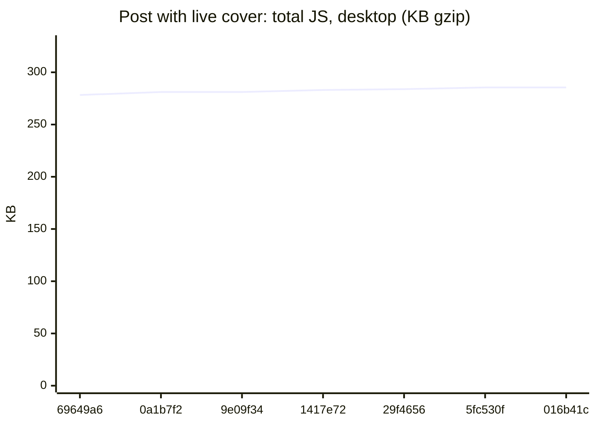

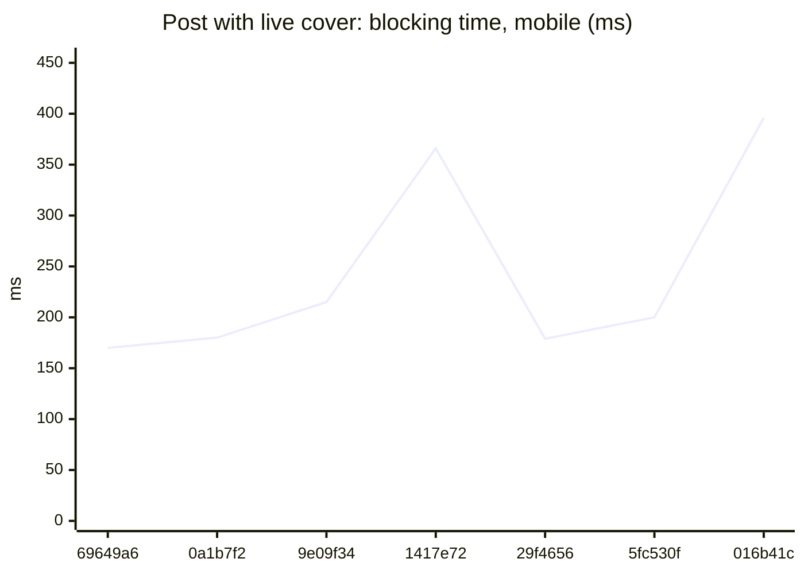

### Post with diagrams

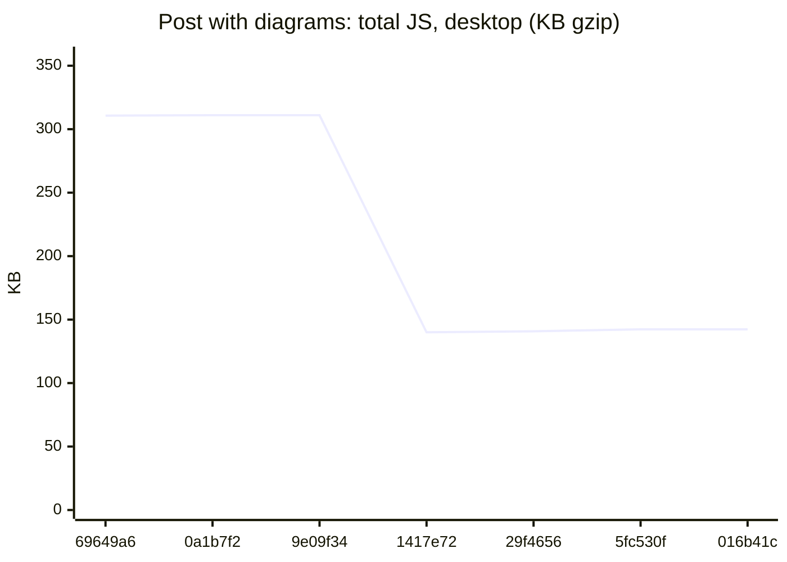

### 404

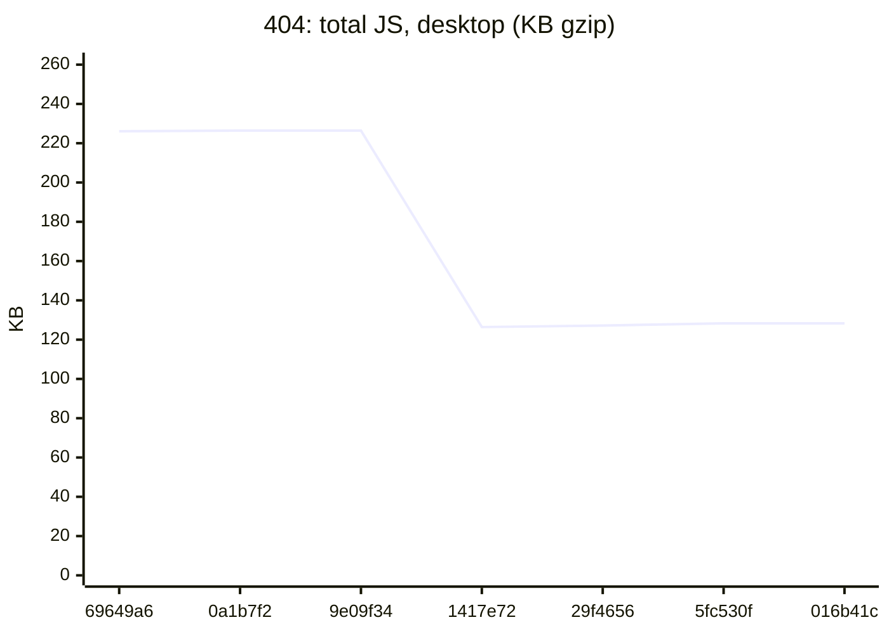

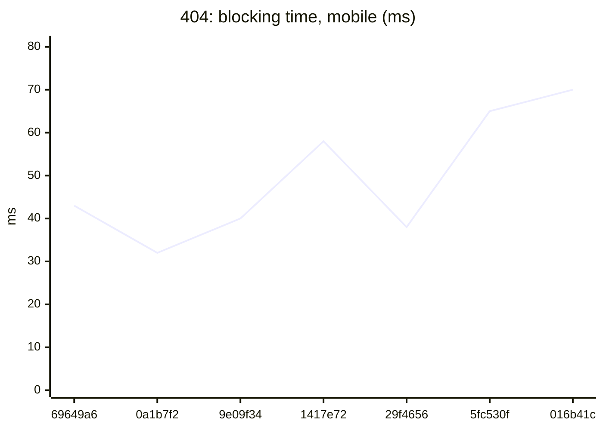
