# Performance history

Measured on every push to `main` by `.github/workflows/perf.yml`; this branch is written by CI only.
JS and CSS sizes are gzip. Timings are medians of 3 loads on a shared runner without a GPU, so watch their trend, not single values.

Latest: [`0a1b7f2`](https://github.com/AxelUser/maltsev.space/commit/0a1b7f234c0006abd16f4002eec8ef9274d92bc0) Feat: cuckoo filter note live cover (#30) (2026-11-18). 2 runs recorded.

## Latest

| Page | Device | Upfront JS | Total JS | Total JS vs [`69649a6`](https://github.com/AxelUser/maltsev.space/commit/69649a642adf9e85fa19759bfed421bfd278cee2) | LCP | Blocking time |
|---|---|--:|--:|--:|--:|--:|
| Home | desktop | 124.4 KB | 125.7 KB | +0.1 KB | 116 ms | 0 ms |
| Home | mobile | 124.4 KB | 125.7 KB | +0.1 KB | 160 ms | 26 ms |
| Blog index | desktop | 120.4 KB | 123.0 KB | +0.1 KB | 124 ms | 0 ms |
| Blog index | mobile | 120.4 KB | 123.0 KB | +0.1 KB | 320 ms | 20 ms |
| About | desktop | 118.3 KB | 124.3 KB | +0.1 KB | 120 ms | 0 ms |
| About | mobile | 118.3 KB | 124.3 KB | +0.1 KB | 152 ms | 11 ms |
| Misc | desktop | 117.4 KB | 124.0 KB | +0.1 KB | 100 ms | 54 ms |
| Misc | mobile | 117.4 KB | 124.0 KB | +0.1 KB | 316 ms | 494 ms |
| Misc collection | desktop | 116.4 KB | 123.0 KB | +0.1 KB | 112 ms | 53 ms |
| Misc collection | mobile | 116.4 KB | 123.0 KB | +0.1 KB | 116 ms | 418 ms |
| Post | desktop | 125.6 KB | 129.0 KB | +0.4 KB | 116 ms | 0 ms |
| Post | mobile | 125.6 KB | 129.0 KB | +0.4 KB | 312 ms | 18 ms |
| Post with live cover | desktop | 125.6 KB | 281.1 KB | +2.8 KB | 204 ms | 319 ms |
| Post with live cover | mobile | 125.6 KB | 138.8 KB | +0.3 KB | 796 ms | 180 ms |
| Post with diagrams | desktop | 125.6 KB | 311.0 KB | +0.3 KB | 104 ms | 0 ms |
| Post with diagrams | mobile | 125.6 KB | 311.0 KB | +0.3 KB | 364 ms | 306 ms |
| 404 | desktop | 26.3 KB | 226.4 KB | +0.3 KB | 96 ms | 0 ms |
| 404 | mobile | 26.3 KB | 226.4 KB | +0.3 KB | 236 ms | 32 ms |

## Trends (last 2 runs)

### Home

```mermaid
xychart-beta
  title "Home: total JS, desktop (KB gzip)"
  x-axis ["69649a6", "0a1b7f2"]
  y-axis "KB" 0 --> 145
  line [125.6, 125.7]
```

```mermaid
xychart-beta
  title "Home: blocking time, mobile (ms)"
  x-axis ["69649a6", "0a1b7f2"]
  y-axis "ms" 0 --> 32
  line [27, 26]
```

### Blog index

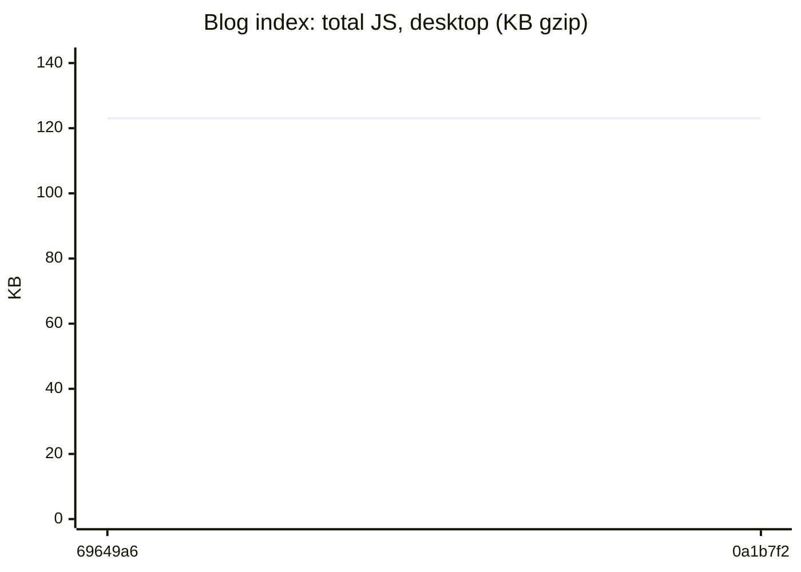

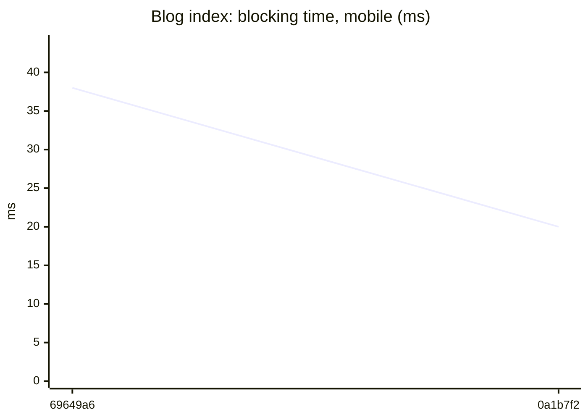

### About

```mermaid
xychart-beta
  title "About: total JS, desktop (KB gzip)"
  x-axis ["69649a6", "0a1b7f2"]
  y-axis "KB" 0 --> 143
  line [124.2, 124.3]
```

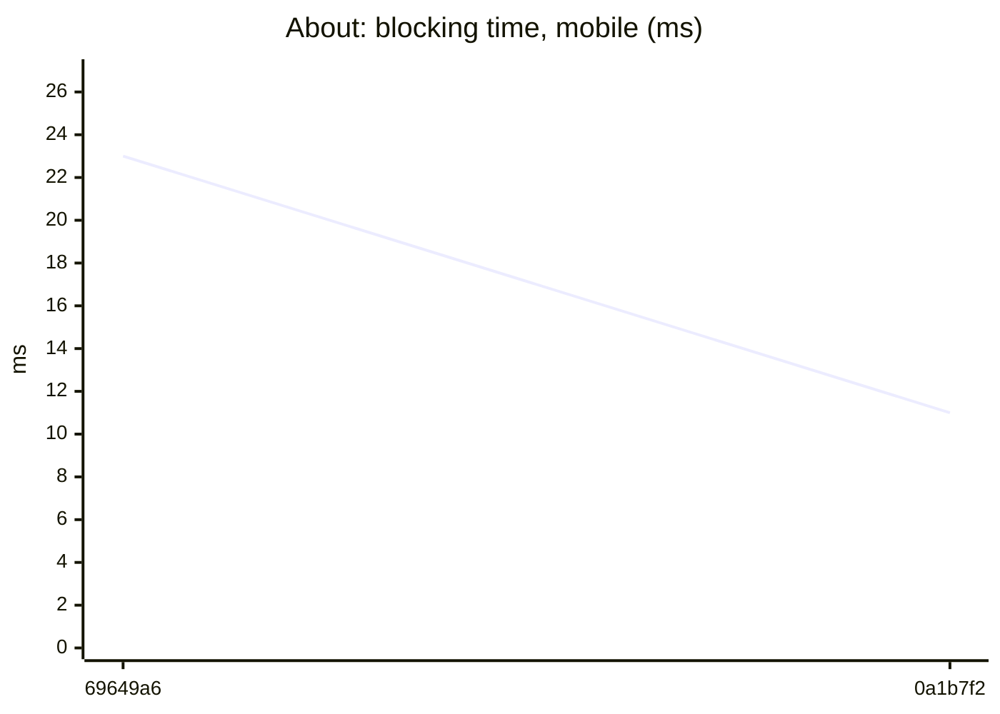

### Misc

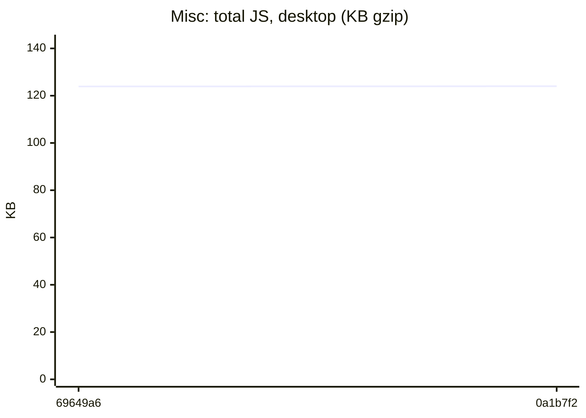

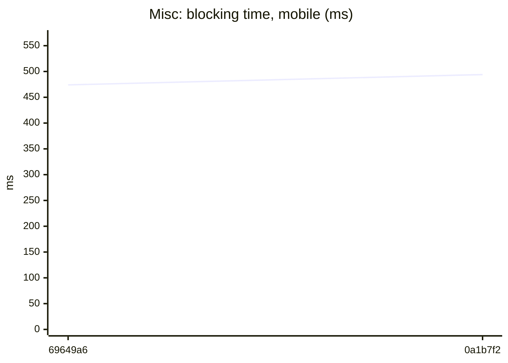

### Misc collection

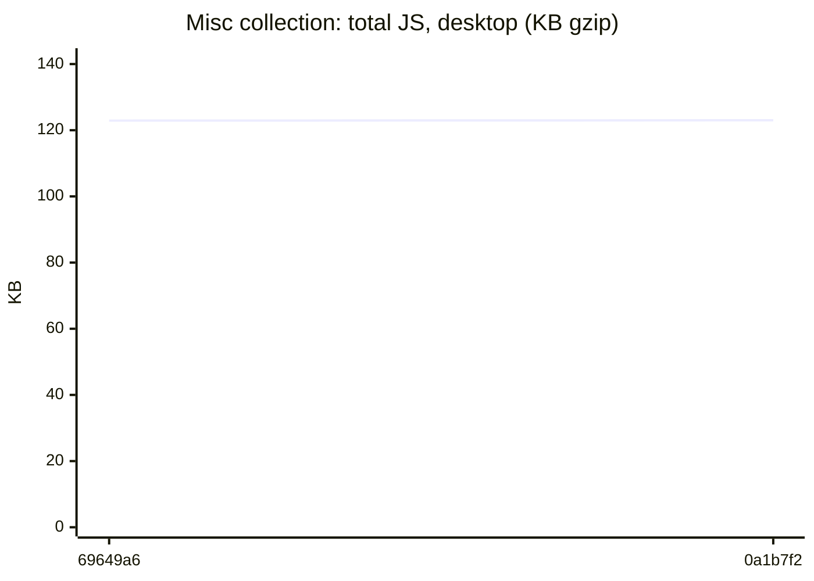

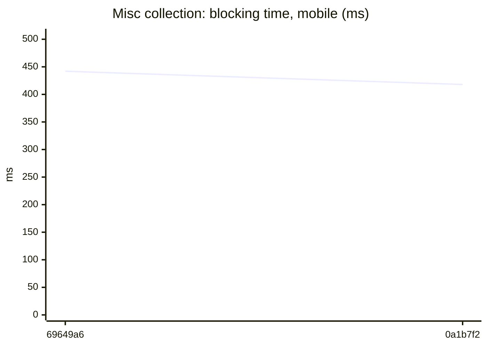

### Post

```mermaid
xychart-beta
  title "Post: total JS, desktop (KB gzip)"
  x-axis ["69649a6", "0a1b7f2"]
  y-axis "KB" 0 --> 149
  line [128.7, 129]
```

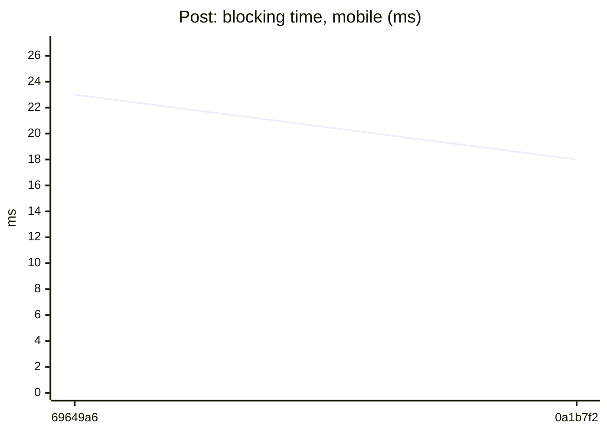

### Post with live cover


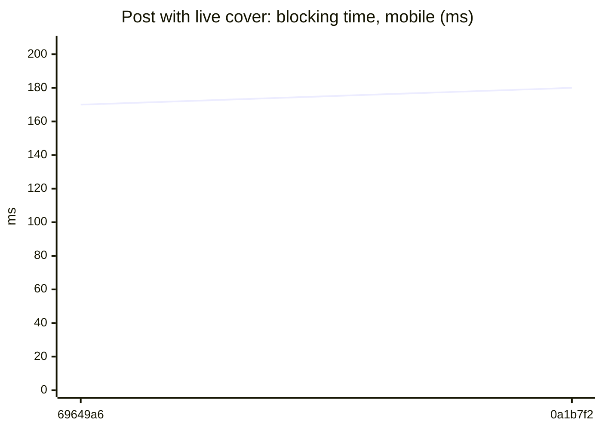

### Post with diagrams


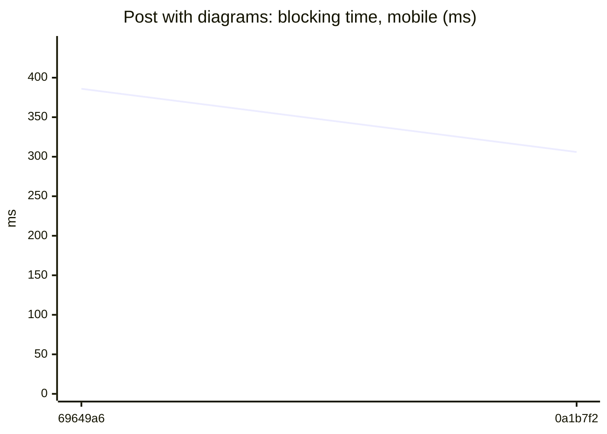

### 404

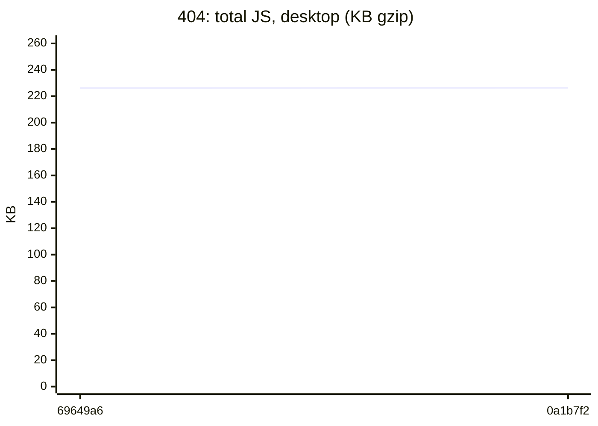

```mermaid
xychart-beta
  title "404: blocking time, mobile (ms)"
  x-axis ["69649a6", "0a1b7f2"]
  y-axis "ms" 0 --> 50
  line [43, 32]
```
